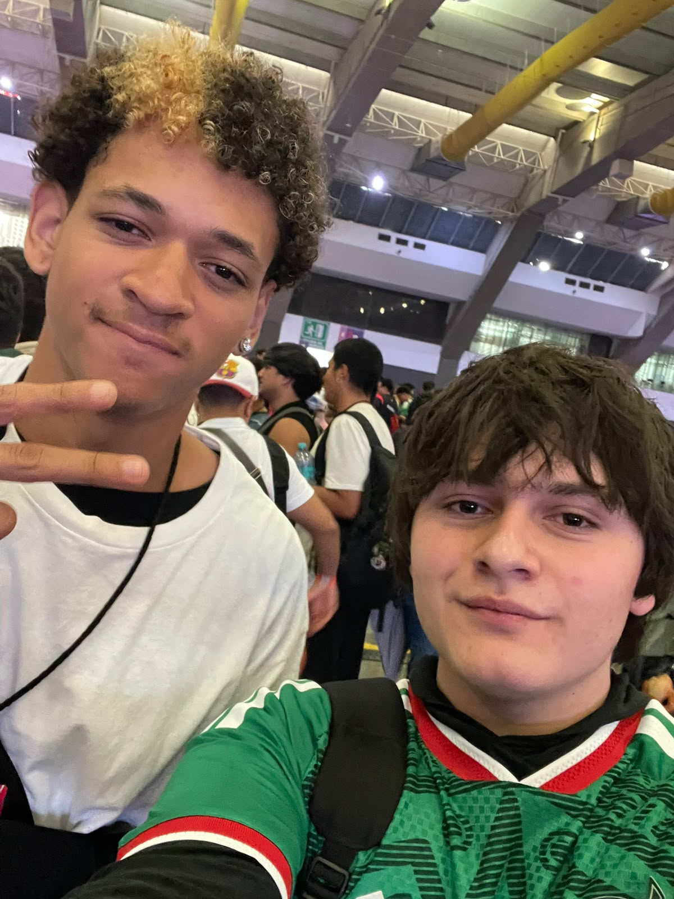

# 🎯 Clase 1
## Quien Soy?
**Soy Andres Galindez Lagunas tengo 18 años y naci el 18 de septiempre**
**Me gusta la musica y los videojuegos**
**Entre a la ibero por motivacion de mis padres**

## Primera Clase
En la primera clase con el profe Oliver, arrancamos configurando nuestra herramienta de trabajo principal: **Visual Studio Code**. 

Básicamente nos enseñó a instalarlo y prepararlo para armar nuestra propia bitácora digital. La idea de esto es ir documentando paso a paso todas las prácticas, proyectos y actividades que vayamos haciendo a lo largo del curso, teniendo todo bien ordenado en un solo lugar. ¡Fue el primer paso para dejar listo nuestro espacio de trabajo!