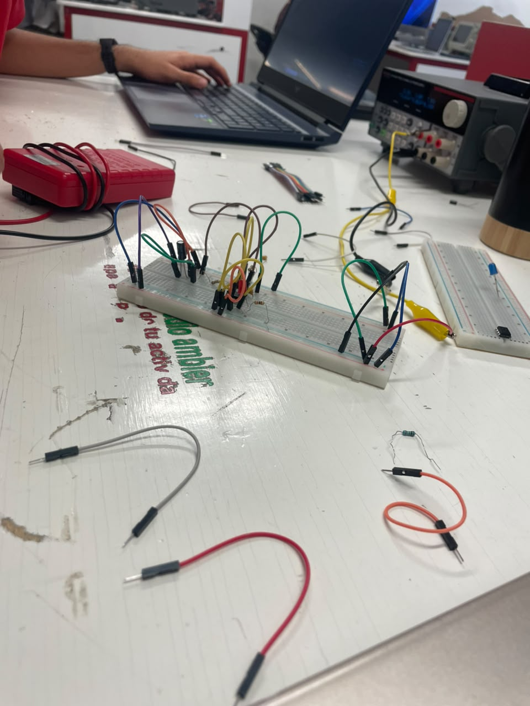
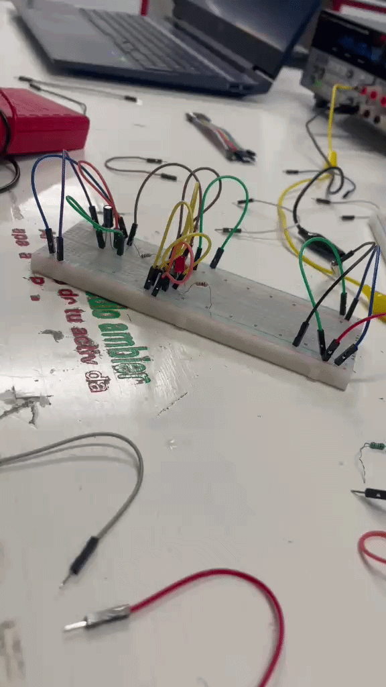

# 🎯 Clase 2
En la segunda sesión de la materia, el maestro Oliver nos puso a chambear directo con la protoboard para aprender a armar nuestros primeros circuitos eléctricos desde cero. 

### 1. Lo básico: LEDs y capacitores
Primero nos explicó cómo está organizada la tablilla por dentro para evitar errores y luego vimos un par de cosas clave:
* **Prender un LED:** Vimos cómo ubicar bien la polaridad (ánodo y cátodo) y por qué hay que usar la resistencia adecuada para no fundir el componente al conectarlo.
* **Uso de capacitores:** Analizamos cómo operan estos elementos dentro de un circuito, entendiendo su función principal para almacenar y liberar energía de forma temporal.

### 2. El reto en equipo: Armar el semáforo
Para cerrar la clase con todo, nos juntamos en parejas para aplicar todo lo que acabamos de aprender. El reto consistía en **diseñar y armar un circuito de semáforo**. 

La dinámica estuvo bastante entretenida porque tuvimos que coordinar los cables, usar los LEDs de colores (rojo, amarillo y verde) y asegurarnos de que todo hiciera buen contacto para que simulara el comportamiento de un semáforo real. Al final, sirvió un montón para agarrarle mejor la onda a las conexiones físicas.

