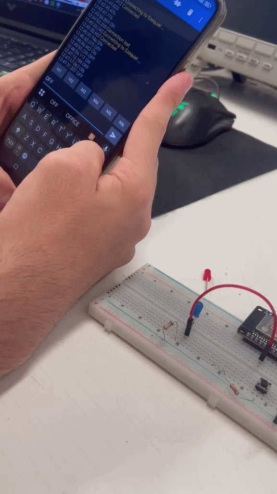

# 🎯 Clase 3: Programación en Arduino, comandos por serial y control por Bluetooth

En la tercera clase con el profe Oliver, pasamos de los puros cables a programar con microcontroladores usando una tarjeta Arduino conectada a la protoboard. 

### 1. Controlando el LED desde la compu
Primero le agarramos la onda al programa de Arduino. El ejercicio inicial estuvo chido porque configuramos el código para abrir el Monitor Serial y, **escribiendo "on" y "off" desde la compu**, hacíamos que el LED prendiera y apagara al instante.
```cpp title="codigo_boton.ino"
void setup() {
  Serial.begin(9600);
  pinMode(14, INPUT);
  pinMode(34, OUTPUT);
}
void loop() {
  if(digitalRead(14) == HIGH) {
    Serial.println("PRESIONADO");
    digitalWrite(34, HIGH);
  } else {
    Serial.println("NO");
    digitalWrite(34, LOW);
  }
```


### 2. Agregando un botón y el Bluetooth
Para cerrar con todo, le subimos de nivel a la práctica con un par de dinámicas:

* **El botón físico:** Conectamos un *push-button* a la tablilla para que, cada vez que lo presionáramos, mandara la señal y cambiara el estado del LED.

* **Control inalámbrico con el cel:** Lo mejor de la clase fue conectar un módulo Bluetooth para enlazarlo con el teléfono. Usamos una app para mandar los mismos comandos de **"on" y "off"** pero ahora directo desde el celular, logrando prender y apagar el foquito a control remoto.
```cpp title="codigo_boton.ino"
#include "BluetoothSerial.h"
BluetoothSerial mi_tel;

void setup() {
  mi_tel.begin("Ezequiel");
  mi_tel.setTimeout(20);
  Serial.begin(9600);
  pinMode(32, OUTPUT);
}

void loop() {
  if (mi_tel.available()) {
    String mensaje = mi_tel.readStringUntil('\n');
    mensaje.trim();
    if (mensaje == "ON") {
      digitalWrite(32, HIGH);
    }
    if (mensaje == "OFF") {
      digitalWrite(32, LOW);
    }
  }
}
```
